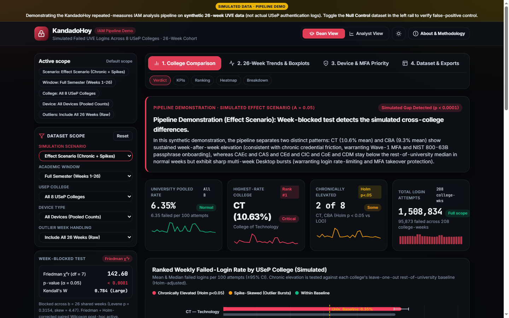
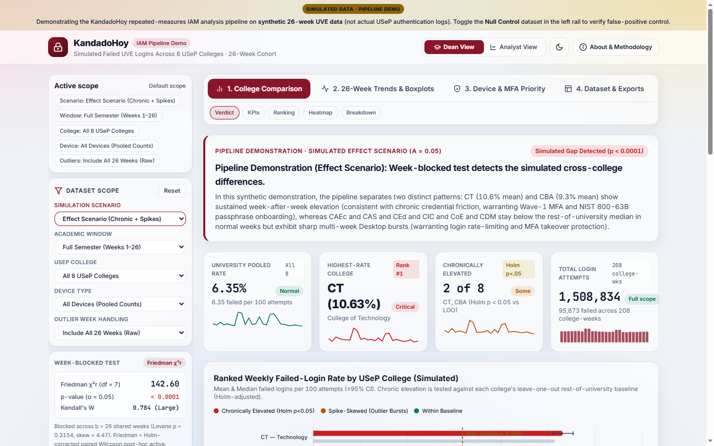

# KandadoHoy

**Live demo: [azgeo.github.io/ic113-dashboard](https://azgeo.github.io/ic113-dashboard/)**

KandadoHoy is an interactive dashboard that demonstrates a repeated-measures statistical pipeline for failed University Virtual Environment (UVE) logins across eight USeP colleges. It turns 26 weeks of login counts into one question a dean can act on: which colleges have a chronic credential problem, and which only have short bursts?

> **All data is simulated.** The 26-week cohort is generated in the browser from a seeded generator (`js/data.js`). It is not real USeP authentication data. A Null-Data Control scenario, with no real college differences, checks that the pipeline does not invent findings.

| Obsidian dark mode | Frosted-glass light mode |
| :---: | :---: |
|  |  |

## What it answers

Failed logins are not all the same problem. A college that is high every week points to password or lockout friction. A college that is normal except for a few sharp weeks points to credential-stuffing bursts. The dashboard separates the two and links each pattern to an Identity and Access Management (IAM) response.

- **Dean View** gives plain-language findings and MFA rollout priorities.
- **Analyst View** adds the omnibus test statistics, p-values, confidence intervals and a manual test override.

## The statistical pipeline

Weeks act as blocks, because every college is measured in the same 26 weeks. That makes the data repeated-measures, so the pipeline uses paired tests.

1. **Pooling.** Counts are pooled by college and week before the rate is computed, which avoids Simpson's paradox across device types.
2. **Assumption checks.** Levene's test and skewness decide which omnibus test runs. The Analyst View can override this choice.
3. **Omnibus test.** The default is the **Friedman test** (χ²r). It is used when variances are unequal or the data is skewed (Levene p < 0.05 or skew > 1.25). Otherwise a repeated-measures ANOVA runs.
4. **Effect size.** **Kendall's W** accompanies Friedman, and partial η² accompanies RM-ANOVA.
5. **Post-hoc: leave-one-out (LOO) comparison.** Each college is tested against the pooled rest of the university with a paired **Wilcoxon** test, or a paired t-test under ANOVA. **Holm** correction controls the family-wise error rate.
6. **Classification.**
   - *Chronically Elevated*: Holm p < 0.05 and a median above the LOO baseline.
   - *Spike-Skewed*: not chronic, but with Tukey outlier weeks (above Q3 + 1.5 × IQR).
   - *Within Baseline*: everything else.

### Views

| Tab | Contents |
| --- | --- |
| College Comparison | Verdict, KPI cards with 26-week sparklines and severity badges, ranked rates with 95% CIs, college-by-week heatmap, statistical breakdown table |
| 26-Week Trends & Boxplots | Longitudinal trajectories, median/IQR boxplots with Tukey outliers |
| Device & MFA Priority | Rates by device type, phased MFA rollout planner, evidence-based recommendations |
| Dataset & Exports | Searchable, sortable records table with inline rate bars; CSV export |

KPI severity badges use these thresholds on the failed-login rate: below 6.5% is Normal, below 8.5% is Elevated, and 8.5% or more is Critical.

### NIST SP 800-63B passphrase checker

An awareness demo on the Device & MFA Priority tab. It applies the NIST guidance that replaced composition rules and forced rotation: a passphrase must be **12 or more characters** and must not match a blocklist of common or institution-specific terms (for example `usep`, `davao`, `password`, `1234`). No symbol or rotation rules are applied.

## Architecture

There is no build step. The project is static files served as-is.

```
index.html        Markup, Tailwind config, section anchors
css/styles.css    Design tokens (dark and light), glass surfaces, component styles
js/data.js        Seeded data generator and all statistics (ANOVA, Friedman, Wilcoxon, Holm)
js/visuals.js     Pure HTML/SVG string builders: sparklines, heatmap grid, search highlight
js/app.js         State, filter pipeline, rendering, charts, interactions
tests/            Node unit tests for js/visuals.js
```

- **Stack:** HTML, CSS, vanilla JavaScript, [Tailwind Play CDN](https://tailwindcss.com/docs/installation/play-cdn) and [Chart.js 4.4](https://www.chartjs.org/). Inter and JetBrains Mono come from Google Fonts.
- **Theming:** all colors are CSS custom properties on `:root` and `html[data-theme="dark"]`. The brand accents are USeP maroon and gold. Green is reserved for the "safe" status.
- **Separation:** `js/visuals.js` never touches the DOM, so it is unit-tested in Node. `js/app.js` calls it and writes the results into the page.
- **Accessibility:** visible keyboard focus, a keyboard-navigable heatmap (arrow keys, Home, End, Escape), and `prefers-reduced-motion` support.

## Run locally

Any static file server works.

```bash
python -m http.server 3000
# or
npx serve -l 3000
```

Open <http://127.0.0.1:3000>. The page loads Tailwind, Chart.js and fonts from CDNs, so it needs an internet connection.

## Verification

- **Unit tests:** `node --test tests/` runs 17 tests, and all 17 pass. They cover the sparkline, heatmap, severity, search-highlight and rate-bar builders, including empty data, zero maximums and HTML or regex characters in the search box.
- **Browser acceptance checks:** run manually with Playwright against the local server. They covered dark and light themes, both views, all four tabs and a 390 px viewport. They found 0 console errors. The only warning is the Tailwind CDN production notice. The checks also confirmed the headline statistics did not change (χ²r = 142.60, pooled rate 6.35%).
- **Not automated:** the Playwright checks are not a committed test suite and do not run in CI.

## Team

Sean Sidrek Tacardon and Azriel Geoff Consencino.
